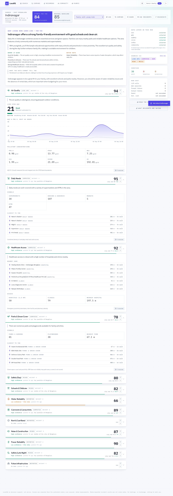

# LocalIQ — Neighbourhood Quality Reports

A multi-agent system that writes a scored, fully cited quality report for any of 34 Bengaluru
localities, shaped to who is asking (family with kids, bachelor, investor, ...). Every number on
screen traces back to a source retrieved during the run; missing data is shown as missing, never
averaged away; and the cost of each report is metered to the token.



| | |
|---|---|
| Backend | FastAPI · MongoDB (Motor) · LangGraph |
| Frontend | React 19 · Tailwind · shadcn/ui |
| Agents | intake → 4 parallel collectors → verifier → scorer → synthesiser → presenter |
| Data | OpenStreetMap Overpass · OpenWeather AQI · Google News RSS + publisher pages · Wikipedia · Reddit |
| LLMs | Groq (`gpt-oss-20b` / `gpt-oss-120b`) or any OpenAI-compatible API, switched by env |
| Quality | 66 golden eval checks · 82 API tests |

Architecture, data model, API reference, cost model and test strategy live in
[`project/docs/`](project/README.md).

## Run it locally

Prerequisites: Python 3.11, Node 20+, Docker.

```bash
# 1. Database
docker compose up -d

# 2. Backend
cd backend
python3.11 -m venv .venv && source .venv/bin/activate
pip install -r requirements.txt
cp .env.example .env              # then add an LLM key (see below)
python seed.py import             # load the 34-locality corpus into MongoDB
uvicorn server:app --port 8001

# 3. Frontend (new terminal)
cd frontend
cp .env.example .env
corepack yarn install
corepack yarn start               # http://localhost:3000
```

Demo accounts are created on startup:

| Email | Password | Plan |
|---|---|---|
| `pro@localiq.in` | `pro12345` | Pro (unlimited reports, compare, recommend) |
| `buyer@localiq.in` | `buyer123` | Free (5 reports) |
| `admin@localiq.in` | `admin123` | Admin |

## Choosing an LLM provider

The agents ask for a *fast* and a *smart* model; the provider decides which ids those are.

| Setup | `.env` |
|---|---|
| Groq (default) — also provides hosted web search | `LLM_PROVIDER=groq` · `GROQ_API_KEY=...` |
| Any OpenAI-compatible API | `LLM_PROVIDER=openai` · `OPENAI_BASE_URL=...` · `OPENAI_API_KEY=...` · `OPENAI_MODEL_FAST=...` · `OPENAI_MODEL_SMART=...` |

Without a Groq key, web research runs on the built-in retrieval pipeline (Google News RSS,
Wikipedia, Reddit) and the configured model only extracts facts from the fetched pages. A model
served from `localhost` (Ollama, LM Studio) is metered at $0.

Presets that work well (model ids current as of November 2026):

| Preset | Cost | `.env` |
|---|---|---|
| Groq, paid Developer tier | ~$1 for 15 reports | `LLM_PROVIDER=groq` · `GROQ_API_KEY=...` |
| Gemini free + Groq free for search | $0, free-tier prompts may be used for training | `LLM_PROVIDER=openai` · `OPENAI_BASE_URL=https://generativelanguage.googleapis.com/v1beta/openai/` · `OPENAI_MODEL_FAST=gemini-3.5-flash-lite` · `OPENAI_MODEL_SMART=gemini-3.5-flash-lite` · `GROQ_API_KEY=...` |
| OpenRouter | pay-as-you-go, cents | `LLM_PROVIDER=openai` · `OPENAI_BASE_URL=https://openrouter.ai/api/v1` · `OPENAI_MODEL_FAST=openai/gpt-oss-20b` · `OPENAI_MODEL_SMART=openai/gpt-oss-120b` |
| Ollama, fully offline | $0, slow on 8 GB machines; fine for chat | `LLM_PROVIDER=openai` · `OPENAI_BASE_URL=http://localhost:11434/v1` · `OPENAI_MODEL_FAST=qwen3:4b` · `OPENAI_MODEL_SMART=qwen3:4b` |

Groq's free tier caps each model at 8K tokens per minute, which is smaller than a research-extraction
request; on that tier the oversized calls fall through to the OpenAI-compatible provider.

## Data

The locality corpus — OSM geometry, air quality and web-research layers per locality — is cached
in MongoDB and shared by every user, so a warm report costs one synthesiser call.

```bash
python warm.py geo                # free layers (OSM + AQI) for all 34 localities
python warm.py web 6              # web-research layers for the 6 least-fresh localities
python seed.py export             # snapshot the corpus to backend/seed/corpus.json.gz
```

Layers expire on a per-domain freshness policy (AQI 6 h, news 7 days, OSM 30 days); a report on a
stale layer re-collects it.

## Tests

```bash
cd backend
python run_evals.py                                            # golden evals, no network
REACT_APP_BACKEND_URL=http://localhost:8001 python -m pytest tests -q   # API suite, needs the backend running
```

Tests that exercise LLM output, payments or air quality need the matching keys in `.env`.
