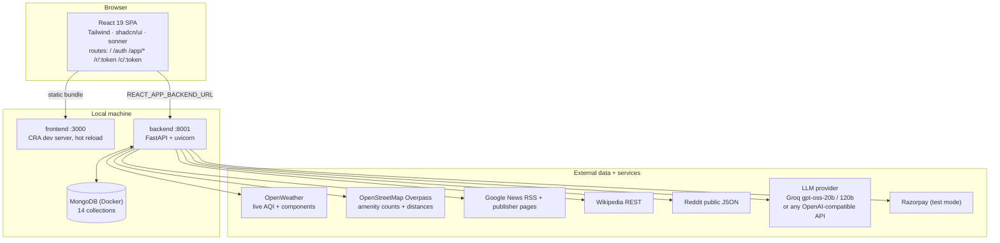
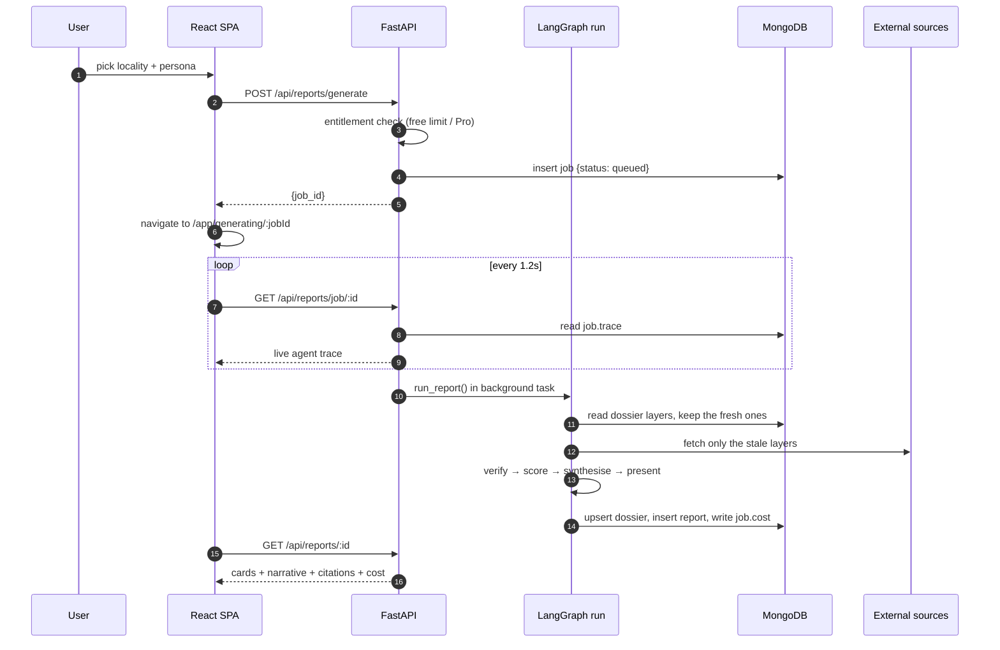

# 01 · System Architecture

## Container view



## Runtime configuration

| Concern | Rule |
|---|---|
| Backend bind | `:8001`, `uvicorn server:app` |
| Frontend bind | `:3000`, `yarn start` |
| API prefix | Every backend route is under `/api`, so one reverse proxy can front both apps in production |
| Frontend → backend | `process.env.REACT_APP_BACKEND_URL` only, never a hardcoded host |
| Backend → Mongo | `MONGO_URL` + `DB_NAME` from `backend/.env` only |
| LLM provider | `LLM_PROVIDER=groq` (`GROQ_API_KEY`) or `openai` (`OPENAI_BASE_URL` + `OPENAI_API_KEY`: OpenAI, Gemini, OpenRouter, Ollama) |
| Secrets | `.env` only: `GROQ_API_KEY`, `OPENAI_API_KEY`, `OPENWEATHER_API_KEY`, `RAZORPAY_*`, `JWT_SECRET` |
| Auth | JWT bearer, stored in `localStorage.lq_token`, sent by an axios interceptor |

## Backend module map

```
backend/
├── server.py                 app factory, CORS, router mounting, startup indexes
└── app/
    ├── config.py             typed settings from .env (fails fast when unset)
    ├── db.py                 Motor client, index creation, utcnow()
    ├── security.py           JWT mint/verify, bcrypt, get_current_user, entitlements
    ├── rubric.py             20 modules, 6 personas, weights, scoring primitives,
    │                         freshness policy, source-type trust ladder
    ├── localities.py         34 Bengaluru localities (slug, pin, lat/lon, zone)
    ├── agents/
    │   ├── graph.py          LangGraph topology + run_report()
    │   ├── collectors.py     air · geo · safety · civic · infra · chatter · community
    │   ├── verifier.py       traceability gate, contradiction detection, confidence
    │   ├── scorer.py         rubric → per-module scores → persona composite
    │   └── presenter.py      typed render blocks + citations + contribution CTAs
    ├── services/
    │   ├── air.py            OpenWeather fetch + CPCB sub-index conversion
    │   ├── geo.py            Overpass queries, haversine, distance buckets
    │   ├── research.py       key-free retrieval: news → publisher → wiki → reddit,
    │   │                     then LLM extraction over the retrieved corpus only
    │   ├── llm.py            provider calls + PRICING + contextvars run ledger
    │   ├── cache.py          freshness policy evaluation for dossier layers
    │   └── advisor.py        grounded chat + SSE streaming, compare, recommend
    ├── evals/                golden.json dataset + deterministic runner
    └── routers/              auth · reports · community · contribute · billing ·
                              share · evals
```

## Report request lifecycle



## Caching strategy

Dossiers are cached **per locality per layer**, not per report. A second user asking for the same
locality reuses every layer still inside its freshness window and pays only for the narrative.

| Layer | Source tier | TTL | Typical cost to refresh |
|---|---|---|---|
| `air` | OpenWeather | 6 hours | free API call |
| `geo` | Overpass / OSM | 30 days | free, ~4-8s |
| `safety` | web research | 7 days | 1 LLM extraction |
| `civic` | web research | 14 days | 1 LLM extraction |
| `infra` | web research | 60 days | 1 LLM extraction |
| `chatter` | Reddit + forums | 7 days | 1 LLM extraction |
| `community` | resident posts | always live | free |

Observed effect: a cold locality run takes up to **165s**, a warm one **~12.7s (p50)** and costs a
single synthesiser call.

## Frontend structure

| Route | Auth | Page |
|---|---|---|
| `/` | public | Landing |
| `/auth` | public | Login / register |
| `/onboarding` | public | Persona + profile capture |
| `/r/:token` | public | Shared read-only report teaser |
| `/c/:token` | public | Resident contribution page |
| `/app` | protected | Home — locality picker, recent reports |
| `/app/generating/:jobId` | protected | Live agent trace |
| `/app/report/:reportId` | protected | Full report + grounded chat |
| `/app/compare` | Pro | Side-by-side comparison |
| `/app/recommend` | protected | Ranked locality recommendation |
| `/app/community` | protected | Posts, claims, proof, votes |
| `/app/account` | protected | Plan, entitlements, billing |
| `/app/trust` | protected | Rubric, freshness, live golden evals |
