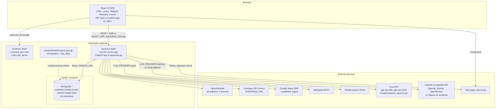
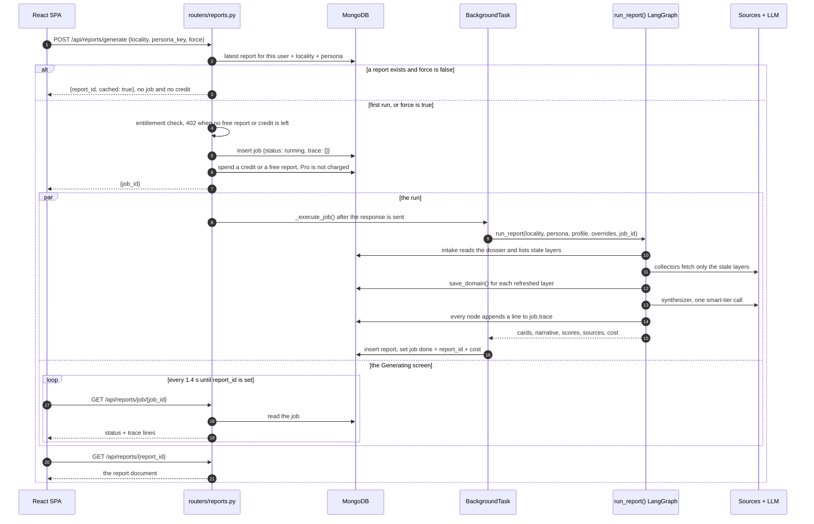
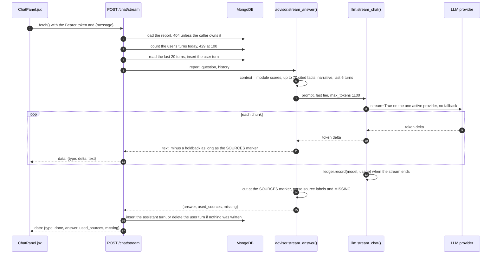

# 01 · System Architecture

LocalIQ is two processes and a database on one machine. MongoDB runs in Docker, the FastAPI
backend runs under uvicorn on port 8001, and the React frontend runs on the CRA dev server on
port 3000. The browser calls the backend directly at `REACT_APP_BACKEND_URL`; there is no proxy in
between.

## Container view

<sub>Source: [`diagrams/system-architecture.mmd`](../diagrams/system-architecture.mmd)</sub>



## Running it

```bash
docker compose up -d                       # mongo:7, container localiq-mongo, volume mongo-data, port 27017

cd backend
python3.11 -m venv .venv && source .venv/bin/activate
pip install -r requirements.txt
cp .env.example .env                       # add an LLM key and an OpenWeather key
python scripts/seed.py import              # load the shared corpus from seed/corpus.json.gz
uvicorn server:app --port 8001

cd ../frontend
cp .env.example .env                       # REACT_APP_BACKEND_URL=http://localhost:8001
corepack yarn install
corepack yarn start                        # http://localhost:3000
```

`backend/server.py` is a one-line ASGI entry (`from app.main import app`). The application object
is built in `backend/app/main.py`: it mounts seven routers, adds CORS from `CORS_ORIGINS`, defines
`GET /api/` and `GET /api/health`, and registers two lifecycle hooks.

On startup, `bootstrap.on_startup()`:

1. creates indexes (`db.ensure_indexes()`, listed in [03](03-data-model.md#indexes));
2. creates or re-passwords the three demo users (`buyer@localiq.in`, `pro@localiq.in`, and the
   admin from `ADMIN_EMAIL` / `ADMIN_PASSWORD`);
3. starts `refresh_city_stats()` as a background task. It recomputes the city percentile table
   only if at least 3 dossiers have a geo layer, and logs a warning instead of failing.

On shutdown the Motor client is closed.

## Configuration

Every setting is read once in `backend/app/config.py` from `backend/.env`. Keys read with
`os.environ[...]` must be present (an empty value is accepted); a missing one raises at import, so
the backend does not start half-configured.

| Variable | Value in `.env.example` | Used by | Notes |
|---|---|---|---|
| `MONGO_URL`, `DB_NAME` | `mongodb://localhost:27017`, `localiq` | `db.py` | required |
| `CORS_ORIGINS` | `http://localhost:3000` | `main.py` | comma-separated; `*` when unset |
| `JWT_SECRET` | `change-me` | `security.py` | HS256 signing key |
| `ADMIN_EMAIL`, `ADMIN_PASSWORD` | `admin@localiq.in`, `admin123` | `bootstrap.py` | admin demo account |
| `LLM_PROVIDER` | `groq` | `services/llm` | `groq` or `openai` (any OpenAI-compatible API) |
| `RESEARCH_PROVIDER` | `auto` | `services/llm` | `auto`, `local` or `groq`; see [05](05-cost-model.md#llm-call-routing) |
| `GROQ_API_KEY` | empty | `groq_provider.py` | |
| `GROQ_MODEL_FAST`, `GROQ_MODEL_SMART`, `GROQ_SEARCH_MODEL` | `openai/gpt-oss-20b`, `openai/gpt-oss-120b`, `openai/gpt-oss-20b` | `config.py` | |
| `OPENAI_BASE_URL`, `OPENAI_API_KEY` | `https://api.openai.com/v1`, empty | `compat_provider.py` | OpenAI, Gemini, OpenRouter, Ollama, LM Studio |
| `OPENAI_MODEL_FAST`, `OPENAI_MODEL_SMART` | `gpt-5.4-mini`, `gpt-5.4` | `config.py` | when SMART is unset, `config.py` uses FAST |
| `RESEARCH_MODEL` | not in the template | `research.py` | model for research planning and extraction; defaults to the fast tier |
| `OPENWEATHER_API_KEY` | empty | `services/air.py` | required key; when empty the air layer fails and is shown as absent |
| `OVERPASS_URL` | two public mirrors | `services/geo.py` | comma-separated, tried in order, two passes |
| `RAZORPAY_KEY_ID`, `RAZORPAY_KEY_SECRET`, `RAZORPAY_WEBHOOK_SECRET` | test placeholders | `routers/billing.py` | test mode |
| `FREE_REPORT_LIMIT` | `5` | `routers/reports.py` | free reports per account |
| `SEARCH_BUDGET_PER_DOSSIER` | `4` | `agents/graph.py` | web-research layers collected per run (4 = all) |

The frontend reads one setting, `REACT_APP_BACKEND_URL`, from `frontend/.env`
(`frontend/.env.example` also sets `BROWSER=none`).

**Auth.** `/api/auth/login` and `/api/auth/register` return a JWT (HS256, 12 hours) in the JSON
body and also set it as an httpOnly `access_token` cookie. The SPA stores the token in
`localStorage.lq_token` and sends it as `Authorization: Bearer` from an axios interceptor
(`src/lib/api.js`) and from the `fetch` call that opens the chat stream. `get_current_user` reads
the cookie first, then the header. A 7-day `refresh_token` cookie is set, but no endpoint reads it.
Five failed logins for the same `ip:email` lock that pair out for 15 minutes (`429`).

## Backend module map

```
backend/
├── server.py                 ASGI entry: from app.main import app
├── app/
│   ├── main.py               FastAPI app, CORS, 7 routers, /api/ and /api/health, lifecycle hooks
│   ├── bootstrap.py          on_startup(): indexes, demo users, background city-stats refresh
│   ├── config.py             Settings from backend/.env
│   ├── db.py                 Motor client, ensure_indexes(), utcnow()
│   ├── security.py           bcrypt, JWT, get_current_user, login lockout
│   ├── localities.py         34 localities: slug, name, pincode, lat/lon, zone, blurb
│   ├── rubric.py             20 modules, 6 personas, select_modules(), composite(),
│   │                         FRESHNESS_POLICY, SOURCE_TYPES, saturation and distance constants
│   ├── rubric_doc.py         per-module formula text served by /api/trust/rubric
│   ├── agents/
│   │   ├── graph.py          LangGraph state, 9 nodes, run_report()
│   │   ├── collectors.py     air, geo, safety, civic, infra, chatter and community collectors
│   │   ├── verifier.py       verify(): traceability gate and dispute detection
│   │   ├── scorer.py         score_all(): rubric arithmetic for every module
│   │   ├── presenter.py      present(): cards, render blocks, citations, contribution prompts
│   │   └── advisor.py        compare, grounded chat (JSON and streaming), recommend
│   ├── services/
│   │   ├── llm/              __init__.py      routing and fallback: chat, chat_json, stream_chat,
│   │   │                                      web_research, extract_json
│   │   │                     groq_provider.py Groq chat, stream, browser_search
│   │   │                     compat_provider.py any OpenAI-compatible API
│   │   │                     ledger.py        PRICING, process-wide and per-run ledgers
│   │   ├── research.py       key-free retrieval, then extraction over the retrieved pages only
│   │   ├── air.py            OpenWeather fetch, CPCB sub-index conversion
│   │   ├── geo.py            one Overpass query per locality, haversine, category summaries
│   │   ├── cache.py          dossier read/write, is_fresh(), stale_domains()
│   │   └── citystats.py      city-wide percentiles per module, 6-hour in-process cache
│   ├── routers/              auth, reports, share, community, contribute, billing, evals
│   └── evals/                golden.json and runner.py
├── scripts/                  warm.py, seed.py, run_evals.py
├── seed/corpus.json.gz       34 dossiers (geo layer) + city_stats, 215 KB
└── tests/                    13 test files, 82 tests, run over HTTP
```

## Frontend structure

```
frontend/src/
├── App.js                    routes, ThemeProvider (next-themes), AuthProvider, sonner Toaster
├── index.css                 design tokens (sage ground, ink, --data blue), Geist and Geist Mono
├── palette.css               generated by scripts/gen-palette.js; do not edit by hand
├── pages/                    Account, Auth, Community, Compare, Contribute, Generating, Home,
│   │                         Onboarding, PublicReport, Recommend, Report, Trust
│   └── landing/              Landing.jsx, landing.css, lens-snapshot.json
├── components/
│   ├── layout/               Shell (nav and footer), ThemeToggle
│   ├── report/               ScorePair, ScoreLedger, ChatPanel, ModuleCard, Renderers,
│   │                         Citation, ModuleIcon
│   ├── community/            ContributeDialog
│   └── ui/                   popover.jsx (Radix), used by Citation
├── context/AuthContext.jsx   session: current user, login, register, logout
└── lib/                      api.js (axios client, Bearer interceptor, formatters), utils.js
```

| Route | Access | Page |
|---|---|---|
| `/` | public | Landing, with a fixed live report that re-scores by persona in the browser |
| `/auth` | public | Sign in / create account |
| `/onboarding` | public route; saving needs a session | Persona and profile questions |
| `/r/:token` | public | Shared report teaser |
| `/c/:token` | public | Resident contribution page |
| `/app` | signed in | Home: locality search, scoring lens, your reports |
| `/app/generating/:jobId` | signed in | Live agent trace |
| `/app/report/:reportId` | signed in, owner | Report, score ledger, grounded chat |
| `/app/compare` | signed in; the API returns `402` unless Pro | Side-by-side comparison |
| `/app/recommend` | signed in; one free run | Ranked shortlist |
| `/app/community` | signed in | Posts, claims, proof, votes |
| `/app/account` | signed in | Plan, entitlements, Razorpay checkout, ledger |
| `/app/trust` | signed in | Rubric, source types, freshness policy, live golden evals |

Any other path redirects to `/`. `/app/*` routes are wrapped in `Protected`, which sends a visitor
without a session to `/auth`.

## Report request lifecycle

<sub>Source: [`diagrams/report-sequence.mmd`](../diagrams/report-sequence.mmd)</sub>



Notes on the sequence:

- The duplicate check is per user, locality and persona. Asking again for a report you already have
  returns the stored one; nothing runs and nothing is charged. `force: true` (the Regenerate button)
  runs the graph again with every layer treated as stale, and is charged again.
- The job is created with `status: running` and the graph runs in a FastAPI `BackgroundTasks`
  callback in the same process. There is no queue or worker; a backend restart abandons a running
  job.
- `src/pages/Generating.jsx` polls the job every 1.4 seconds and navigates to the report when
  `report_id` appears.

## Streaming chat

<sub>Source: [`diagrams/chat-stream-sequence.mmd`](../diagrams/chat-stream-sequence.mmd)</sub>



The response is `text/event-stream` with three frame types: `delta`, `done` and `error`. The model
is told to finish with two trailer lines, `###SOURCES###` and `###MISSING###`. `stream_answer()`
keeps the last 12 characters of its buffer unsent (one less than the marker's length), so a
marker split across two chunks is never sent to the browser, and it stops emitting once the marker
appears. `test_streaming_adversarial.py` checks that the marker never reaches the client.

## Caching, in one paragraph

Expensive collection is cached per locality and per layer in the `dossiers` collection, not per
user or per report. Each layer has its own time-to-live (`FRESHNESS_POLICY`); a run refreshes only
the layers past their TTL. A run on a fully fresh locality makes one LLM call, the synthesizer.
The policy and the corpus lifecycle are in [03 · Data model](03-data-model.md#corpus-lifecycle);
every mechanism that saves calls is listed in [08 · Call optimizations](08-call-optimizations.md).
