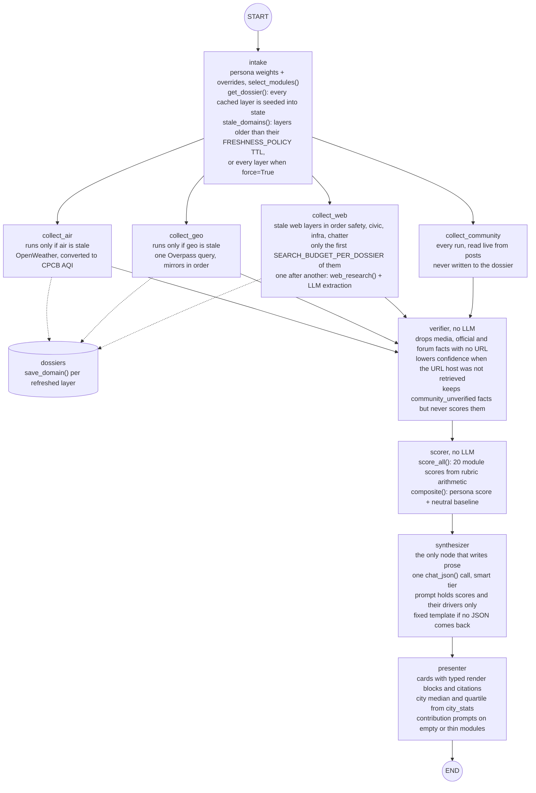
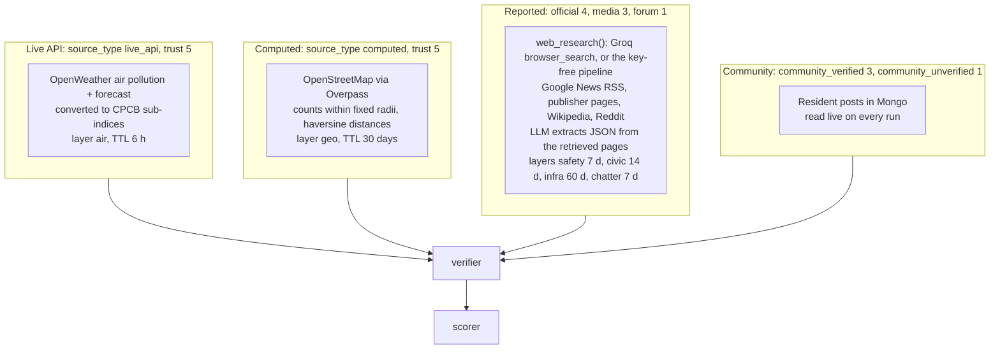
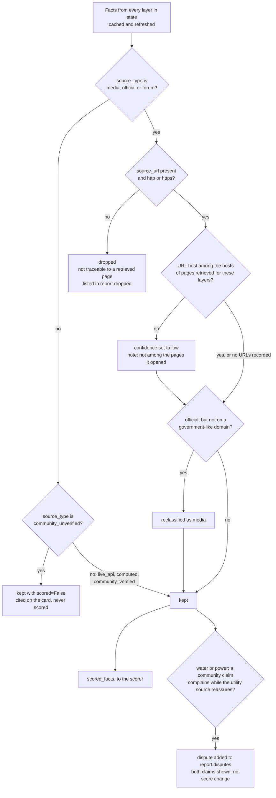
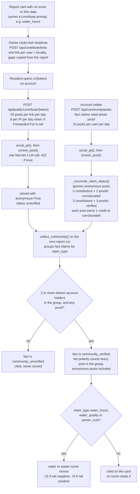

# 02 · Agent Architecture

A report is produced by one LangGraph graph with 9 nodes (`backend/app/agents/graph.py`). Four
collectors run in parallel, a deterministic verifier and scorer follow, and the synthesizer is the
only node that writes prose. Comparison, recommendation and chat are separate agents in
`backend/app/agents/advisor.py`; they reuse the same scorer and rubric.

## Report graph

<sub>Source: [`diagrams/agent-graph.mmd`](../diagrams/agent-graph.mmd)</sub>



`build_graph()` wires `START → intake`, an edge from `intake` to each of the four collectors, an
edge from each collector to `verifier`, then `verifier → scorer → synthesizer → presenter → END`.
LangGraph runs the four collectors in the same step and waits for all of them before the verifier.

**State.** `GState` is a `TypedDict`. Only `domains` has a reducer (`merge_dicts`), because it is
the only key that more than one node writes: intake seeds it with every cached layer, then the four
collectors each return `{"domains": {<layer>: payload}}` in the same step. A collector that does not run, or fails,
returns nothing, so the cached copy seeded by intake stays in state.

**Trace.** Every node calls `emit()`, which appends `{t, agent, message, status, meta}` to
`job.trace`. The Generating screen polls the job and renders these lines. Runs started by
`/lens` and `/compare` have no job, so they emit nothing.

### Node contracts

| Node | Reads | Writes | LLM calls |
|---|---|---|---|
| `intake` | locality, `persona_key`, `overrides`, `force`, the dossier | `weights`, `selected`, `stale`, `domains` (cached layers), `started_at` | 0 |
| `collect_air` | lat/lon, `stale` | `domains.air`; dossier via `save_domain()` | 0 |
| `collect_geo` | lat/lon, `stale` | `domains.geo`; dossier | 0 |
| `collect_web` | locality, `stale`, `SEARCH_BUDGET_PER_DOSSIER` | `domains.safety`, `.civic`, `.infra`, `.chatter`; dossier | per layer: 1 Groq `browser_search` call, or 2 calls on the key-free path; +1 repair call when the reply has no JSON |
| `collect_community` | `posts` for the locality | `domains.community` (not saved to the dossier) | 0 |
| `verifier` | `facts` and `urls` of every layer in `domains` | `facts`, `verified` (kept, dropped, disputes, stats) | 0 |
| `scorer` | `verified.scored_facts`, raw layer payloads, `weights` | `module_scores`, `composite`, `baseline_composite` | 0 |
| `synthesizer` | module scores and drivers, persona, profile, disputes | `narrative` | 1, smart tier |
| `presenter` | everything above, `city_stats` | `cards` | 0 |

### The freshness decision

`node_intake` calls `stale_domains(slug, ALL_DOMAINS, force)` from `services/cache.py`. A layer is
stale when it has no `collected_at`, or `collected_at` is older than its TTL in
`rubric.FRESHNESS_POLICY`, or `force=True`. `community` has a TTL of 0, so it is always stale and is
read from `posts` on every run. Each collector node starts with `_skip(state, layer)` and returns
immediately when its layer is fresh.

### The search budget

`collect_web` takes the stale web layers in the fixed order `safety, civic, infra, chatter`, keeps
the first `SEARCH_BUDGET_PER_DOSSIER` of them, and runs them one after another rather than in
parallel. These are the only metered, rate-limited calls in the graph. The template sets the
budget to 4, which collects every stale web layer; a lower value defers the rest to a later run.
For each layer the outcome is one of three:

| Outcome | What happens |
|---|---|
| `ok` | layer saved to the dossier with a new `collected_at`, trace shows pages read and facts kept |
| `rate_limited` (Groq returned 429) | trace says the research budget was reached; the cached copy from intake stays in state |
| no usable data | trace says the layer will be shown as absent; any cached copy stays in state |

## The four data tiers

<sub>Source: [`diagrams/data-tiers.mmd`](../diagrams/data-tiers.mmd)</sub>



**Tier 3 is retrieval first.** With `RESEARCH_PROVIDER=local`, or `auto` without a Groq key, or when
Groq search fails under `auto`, `services/research.py` does the research:

1. `_plan()`: one LLM call turns the collector's brief into 4 to 6 news queries and up to 2
   Wikipedia titles.
2. `_gather()`: Google News RSS (4 items per query, de-duplicated by title, at most 11 kept);
   each Google News link is decoded to the publisher's URL and the page is fetched. If the
   publisher blocks the fetch, the headline is kept and labelled `news-headline`. Wikipedia
   summaries and one Reddit search are added. At most 10 documents of 3,800 characters each.
3. One LLM call extracts the collector's JSON schema from that corpus only. The system prompt says
   every claim must carry a `source_url` copied from a document block.

The returned `urls` are the documents' URLs, so the verifier checks citations against pages that
were actually fetched. With Groq search, `urls` are the URLs found in the `browser_search` tool
output.

## The trust gate

<sub>Source: [`diagrams/trust-pipeline.mmd`](../diagrams/trust-pipeline.mmd)</sub>



`verify()` in `agents/verifier.py` is deterministic. What it does and does not do:

- It **drops** a `media`, `official` or `forum` fact only when the fact has no `http(s)` URL.
- A URL whose host is not among the hosts of the retrieved URLs is **kept with low confidence**,
  not dropped. The check compares hosts, not full URLs, and is skipped when no URLs were recorded.
- A fact typed `official` whose host does not contain a government-like hint (`gov.in`, `nic.in`,
  `bmrcl`, `bwssb`, `bescom`, `bbmp`, `bda.`, `karnataka`) is reclassified as `media`.
- `community_unverified` facts are kept with `scored=False`: they appear as citations and are
  excluded from `scored_facts`.
- Disputes are detected only for water and power: a community claim that complains (`cut`,
  `outage`, `tanker`, ...) while the utility fact reassures (`normal`, `uninterrupted`, ...). The
  dispute is added to `report.disputes` and shown on the report; scores are not changed.

The report shows the counters `kept`, `dropped` and `disputed`, and lists the dropped facts.

## Scoring

All scoring is arithmetic in `agents/scorer.py` and `rubric.py`. No LLM produces or adjusts a
score.

```
module score   rubric primitive over verified facts: saturating(n, k), distance_score(m, good, bad),
               aqi_to_score(aqi), blended with fixed weights; None when the inputs are missing
composite      Σ(score × weight) / Σ(weight), over modules that have a score and a weight > 0
coverage       Σ(weights of scored modules) / Σ(all positive weights)
confidence     high at coverage ≥ 80 %, medium at ≥ 55 %, else low
baseline       the same composite with every weight = 1
```

- **Absence is not averaged.** A module with no score is left out of both sums and is rendered as
  an empty card with a contribution prompt.
- **Saturation.** `saturating(n, k) = 100 × (1 − e^(−n/k))`. The constants in `rubric.K` were
  calibrated so the median locality lands near 55 (`nightlife 25`, `restaurant 110`, `parks 110`,
  `schools 70`, ...) and are frozen by the golden dataset.
- **Module selection is separate from the composite.** `select_modules()` keeps modules with
  persona weight ≥ 2 plus `air_quality`, `safety_day`, `commute` and `infrastructure`, then
  applies the user's dropped and added overrides. The selection decides which cards are shown and
  what the synthesizer writes about. The composite runs over all 20 module scores with the
  persona's weights, so a weight-1 module that is not shown still counts.

### Personas

| Persona key | Label | Weight 3 |
|---|---|---|
| `bachelor` | Bachelor / Young professional | nightlife, food, commute, safety_night, cost |
| `student` | Student | cost, commute, food, daily_needs |
| `family_kids` | Family with young kids | schools, safety_day, healthcare, parks, air_quality, daily_needs, water |
| `elderly` | Living with elderly parents | healthcare, safety_day, air_quality, parks, daily_needs, noise, water, power |
| `wfh_pro` | Work-from-home professional | internet_wfh, power, noise, air_quality, water |
| `investor` | Investor / ROI | infrastructure, investment, commute, cost |

### Modules by tier

| Tier (`MODULES[...]["tier"]`) | Modules |
|---|---|
| Live API | air_quality |
| Computed | commute, nightlife, food, parks, healthcare, daily_needs, fitness, worship, pet_friendly |
| Mixed | safety_day, safety_night, schools, noise, internet_wfh |
| Reported | water, power, cost, infrastructure, investment |

## Synthesizer

- One `chat_json()` call on the smart tier with `max_tokens=1800`.
- The prompt carries the locality, the persona and its summary, the profile (truncated to 900
  characters), the persona score and baseline, one line per selected module (`score` or `NO DATA`,
  weight, driver values) and any disputes. Raw pages, dropped facts and forum quotes are not in it.
- The system prompt forbids numbers that are not in the facts, claims that a locality is unsafe for
  a group, investment guarantees, and medical or legal advice.
- The requested JSON has `headline`, `living_here`, `for_you`, `wins[]`, `watchouts[]`,
  `blind_spots[]`, `modules{}` and `verdict`. The code checks only that a JSON object came back;
  it does not validate the fields.
- If no object comes back (provider down, no key, malformed reply) the node stores a fixed
  template: a headline with the score and the sentence "Narrative generation was unavailable for
  this run." Scores, cards and citations are unaffected.

## Advisor agents

```mermaid
flowchart TB
    subgraph CMP["Compare: POST /api/compare, Pro only"]
        C1["2 or 3 locality slugs"] --> C2["run_report() per locality, force=False<br/>fresh layers reused, stale layers refreshed<br/>the synthesizer runs for each locality"]
        C2 --> C3["compare_localities()<br/>1 chat_json() call, smart tier<br/>input: module scores only"]
        C3 --> C4["verdict, trade-off, decider<br/>returned, not stored"]
    end

    subgraph REC["Recommend: POST /api/recommend, 1 free run, then Pro"]
        R1["10 candidates: nearest to profile.work_locality,<br/>else localities that have a dossier first"] --> R2["_quick_dossier() for each, 3 at a time<br/>air + geo only, refreshed if stale<br/>no web research, no LLM"]
        R2 --> R3["verify(), score_all(), composite()<br/>top 5 by persona score"]
        R3 --> R4["recommend()<br/>1 chat_json() call, smart tier"]
        R4 --> R5["stored in recommendations"]
    end

    subgraph CHAT["Chat: POST /api/reports/{id}/chat and /chat/stream"]
        H1["context from the stored report:<br/>scores, cited facts, narrative, last 6 turns"] --> H2["answer_question(): chat_json()<br/>or stream_answer(): stream_chat()<br/>fast tier, max_tokens 1100"]
        H2 --> H3["answer, used_sources, missing<br/>stored in chat_messages<br/>100 user turns per user per day"]
    end
```

<sub>Source: [`diagrams/advisor-agents.mmd`](../diagrams/advisor-agents.mmd)</sub>



| Agent | Function | LLM calls | Notes |
|---|---|---|---|
| Compare | `compare_localities()` | 1 smart, plus one `run_report()` per locality | each `run_report()` runs the full graph, so the synthesizer runs once per locality even though compare uses only its headline |
| Recommend | `recommend()` | 1 smart | candidates are scored from air and geo only, through the same `verify()`, `score_all()` and `composite()` |
| Chat | `answer_question()` | 1 fast | JSON reply: `answer`, `used_sources`, `missing` |
| Streaming chat | `stream_answer()` | 1 fast, streamed | plain text plus the `###SOURCES###` / `###MISSING###` trailer, parsed server-side |

Chat context is built from the stored report: module scores and reasons, up to 6 citations per
card (70 in total), the narrative (1,200 characters) and the last 6 turns. The system prompt
restricts answers to those facts and asks the model to say what is missing.

The suggested questions in `ChatPanel.jsx` are built in the browser from the report's cards: the 5
highest-weighted modules that have data, one question about the first empty module, and one about
blind spots. They cost no LLM call.

## Contribution pipeline

<sub>Source: [`diagrams/contribution-flow.mmd`](../diagrams/contribution-flow.mmd)</sub>



Two rule sets apply to community claims, and they are not the same:

| Rule | Where | Condition |
|---|---|---|
| Post status shown in the feed | `routers/community.py`, `_reconcile_claim_status()` | `corroborated` at 2 account holders and 2 proofs; `verified` at 3 and 3; anonymous posts excluded |
| Whether a claim is scored | `agents/collectors.py`, `collect_community()` | at least 2 distinct account holders in the claim-type group and at least one proof in the group |

Only three claim types are read by the scorer: `water_hours` and `water_quality` move `water`,
`power_cuts` moves `power`, by −15 for a net-negative group or +6 for a net-positive one. Polarity is
keyword-based (`claim_polarity()`) and counts every post in the group, including anonymous ones.
So anonymous posts cannot make a claim scored, but once two account holders have made it, they do
count toward the direction it moves.
