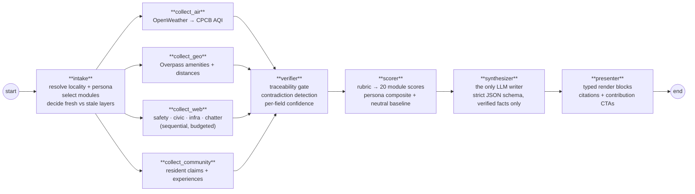
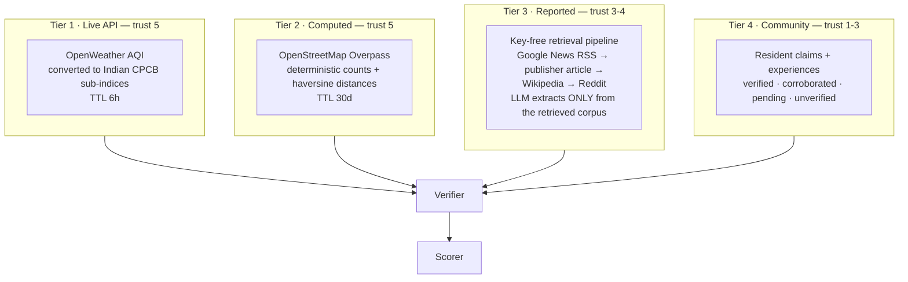
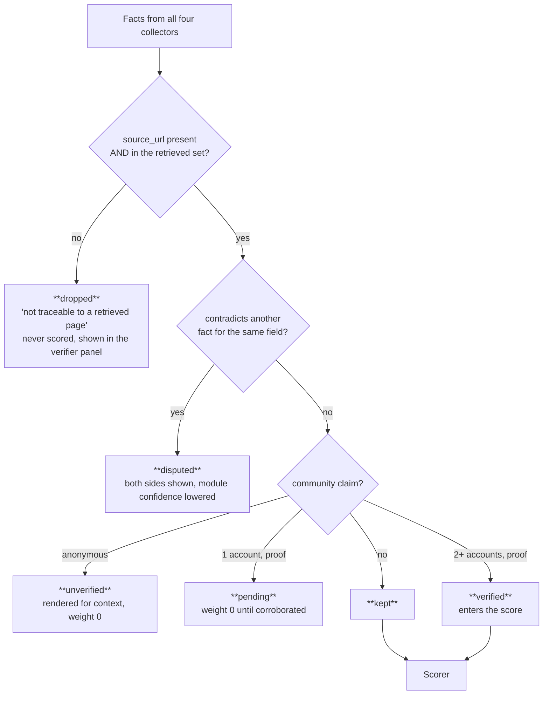
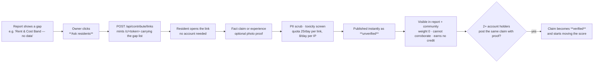

# 02 · Agent Architecture

Eight nodes, one LangGraph. The collectors fan out in parallel, everything converges on a
deterministic trust gate, and only one node in the whole graph is allowed to write prose.

## Topology



Graph state is a `TypedDict` merged with a dict-merge reducer, so the four collectors can write
into `raw` and `facts` concurrently without clobbering each other.

## Node contracts

| Node | Reads | Writes | LLM |
|---|---|---|---|
| `intake` | locality slug, persona, profile, dossier freshness | selected modules, stale-layer list | no |
| `collect_air` | lat/lon | live AQI, pollutant components, 24h series | no |
| `collect_geo` | lat/lon | amenity counts, nearest-N with distances | no |
| `collect_web` | locality name | safety / civic / infra / chatter facts + source URLs | yes (extraction) |
| `collect_community` | locality slug | resident claims, corroboration state | no |
| `verifier` | all facts + the set of URLs actually retrieved | kept / dropped / disputed | no |
| `scorer` | verified facts | per-module score, confidence, persona composite | no |
| `synthesizer` | scored modules + verified facts + profile | narrative JSON | **yes** |
| `presenter` | everything | render blocks, citations, empty-state CTAs | no |

Every node emits a trace line to `job.trace`, which is what the Generating screen streams.

## The four data tiers



**Why Tier 3 is retrieval-first.** The LLM never answers from parametric memory. `research.py`
resolves Google News links back to the publisher's own URL, pulls the article body, adds a Wikipedia
extract and Reddit threads, builds a corpus string, and only then asks the model to extract
structured facts *with the source URL attached to each one*. A fact whose URL is not in the corpus
cannot survive the verifier.

## The trust gate



Counters from every run are surfaced in the report's verifier panel: *kept · dropped · disputed*.

## Scoring

```
module_score  = rubric primitive over verified facts        # saturating(), distance_score(), aqi_to_score()
confidence    = f(source trust ladder, corroboration, freshness)
persona_score = Σ(module_score × persona_weight) / Σ(weights of modules that actually scored)
baseline      = the same, with every weight equal
```

Three rules make the number honest:

1. **Absence is never averaged.** An unscored module is excluded from both numerator and
   denominator, and rendered as an explicit gap.
2. **Saturation, not linearity.** `saturating(n, k)` means the 40th restaurant adds far less than
   the 4th. Constants are calibrated across all 34 localities (`nightlife 25 · restaurant 110 ·
   parks 110 · schools 70`) and frozen in the golden dataset.
3. **Persona changes weights only.** `POST /api/reports/:id/lens` re-scores the stored dossier —
   free, instant, no LLM call, and the neutral baseline is always shown next to the persona score.

### Personas

| Persona | Heaviest weights |
|---|---|
| Bachelor / young professional | nightlife, food, commute, safety (night), cost |
| Student | cost, commute, food, daily needs |
| Family with young kids | schools, safety (day), healthcare, parks, air quality |
| Living with elderly parents | healthcare, safety (day), air quality, parks, daily needs |
| Work-from-home professional | internet/WFH, power, noise, air quality, water |
| Investor / ROI | infrastructure, investment, commute, cost |

### Modules by tier

| Tier | Modules |
|---|---|
| Live API | air_quality |
| Computed (OSM) | commute, nightlife, food, parks, healthcare, daily_needs, fitness, worship, pet_friendly |
| Mixed | safety_day, safety_night, schools, noise, internet_wfh |
| Reported | water, power, cost, infrastructure, investment |

## Synthesiser guardrails

- Fixed JSON schema: `headline · living_here · for_you · wins[] · watchouts[] · blind_spots[] ·
  modules{} · verdict`.
- The prompt carries **only verified facts** plus the persona profile; dropped facts never reach it.
- `blind_spots` is mandatory — the model has to state what it could not tell the user.
- Output is parsed and validated; a malformed response falls back to a deterministic template rather
  than shipping prose that is not grounded.

## Grounded chat

`POST /api/reports/:id/chat/stream` streams Server-Sent Events. The context is the stored report
dossier only. The model emits its answer, then a `###SOURCES` block that the backend parses into
citation chips — the adversarial suite (`test_streaming_adversarial.py`) specifically tries to make
the marker leak into user-visible text.

Suggestion chips are built client-side from the report's own scored modules (top 5 by persona
weight) plus one gap question and one blind-spot question: zero LLM cost, and impossible to suggest
a question the report cannot answer.

## Contribution pipeline


