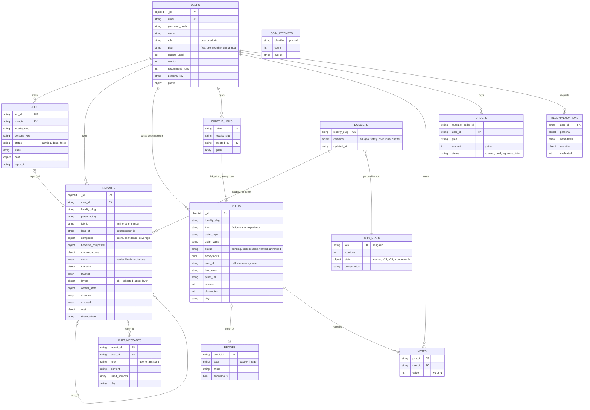
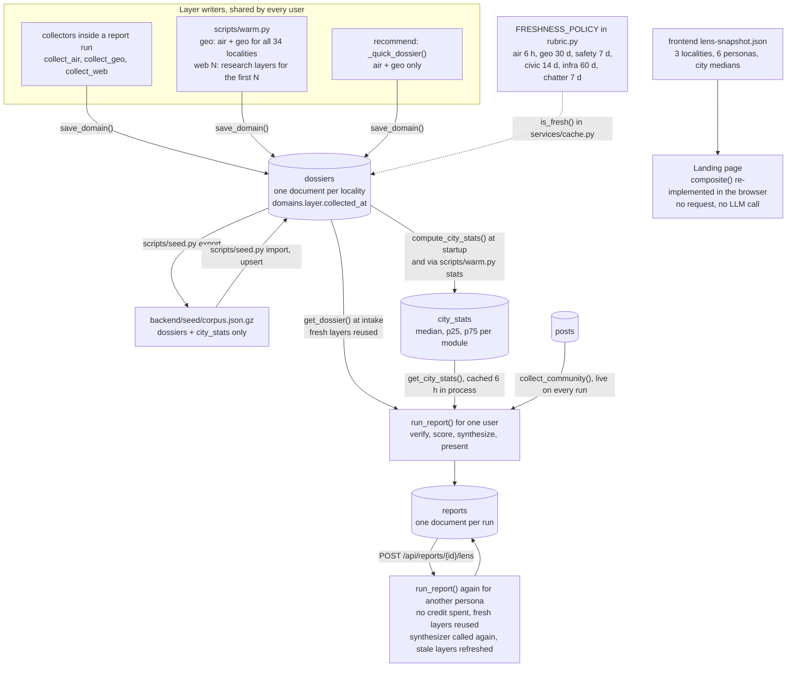

# 03 · Data Model

MongoDB 7 in Docker, accessed through Motor. There are 14 collections: 13 are written by the
code, and `traces` only has an index created at startup (nothing writes to it). Routers convert
`_id` to a string `id` before returning a document.

## Entity relationships

<sub>Source: [`diagrams/data-model.mmd`](../diagrams/data-model.mmd)</sub>



## Collections

| Collection | Written by | Purpose and notable fields |
|---|---|---|
| `users` | `routers/auth.py`, `bootstrap.py`, billing, community | account and entitlements: `plan`, `reports_used`, `credits`, `recommend_runs`, `persona_key`, `profile` |
| `jobs` | `routers/reports.py` (`/generate`) | one agent run: `status`, `trace[]`, `cost`, `report_id`, `error` |
| `reports` | `/generate` (via the job), `/lens` | one document per run: `cards[]`, `composite`, `baseline_composite`, `module_scores`, `narrative`, `sources[]`, `layers`, `verifier_stats`, `disputes`, `dropped`, `cost`; `lens_of` on lens reports; `share_token` once shared |
| `dossiers` | `services/cache.save_domain()` | the shared cache: one document per locality, `domains.<layer>` = `{ok, facts, raw, urls, collected_at}` for `air`, `geo`, `safety`, `civic`, `infra`, `chatter` |
| `city_stats` | `services/citystats.compute_city_stats()`, `scripts/seed.py import` | one document, `key: bengaluru`: median, p25, p75 and n per module |
| `posts` | community and contribute routers | fact claims and experiences: `status`, `anonymous`, `link_token`, `proof_url`, `sentiment`, `topics`, `pii_scrubbed`, `credit_granted`, `day` |
| `proofs` | `POST /community/proof`, `POST /public/contribute/{token}/proof` | base64 image (≤ 3 MB decoded) and MIME type |
| `votes` | `POST /community/posts/{id}/vote` | one per user per post, `value` ±1 |
| `contrib_links` | `POST /contribute/links` | `token`, `locality_slug`, `created_by`, `gaps[]` (up to 6) |
| `chat_messages` | both chat endpoints | `role`, `content`, `used_sources`, `missing`, `day` (for the daily cap) |
| `orders` | billing router | Razorpay order id, `plan`, `amount` (paise), `status`: created, paid or signature_failed |
| `recommendations` | `POST /recommend` | the full recommendation result per run |
| `login_attempts` | `security.py` | failed logins per `ip:email`, deleted on success or after the 15-minute lockout |
| `traces` | nothing | index only |

## Indexes

Created on every startup by `db.ensure_indexes()`:

```
users            email                                   unique
login_attempts   identifier
dossiers         locality_slug                           unique
reports          (user_id, created_at desc)
reports          (user_id, locality_slug, persona_key)   the duplicate-report lookup in /generate
jobs             (user_id, created_at desc)
posts            (locality_slug, created_at desc)
posts            (link_token, day)                       per-link daily quota
votes            (post_id, user_id)                      unique: one vote per user per post
chat_messages    (report_id, created_at)
traces           job_id
orders           razorpay_order_id
contrib_links    token                                   unique
contrib_links    (created_by, locality_slug)
```

`jobs.job_id` and `reports.share_token` are queried but not indexed.

## Freshness policy

`rubric.FRESHNESS_POLICY`, evaluated by `services/cache.is_fresh()` against each layer's
`collected_at`.

| Layer | TTL | Source |
|---|---|---|
| `air` | 6 hours | OpenWeather |
| `geo` | 30 days | Overpass / OpenStreetMap |
| `safety` | 7 days | web research |
| `civic` | 14 days | web research |
| `infra` | 60 days | web research |
| `chatter` | 7 days | web research |
| `community` | 0, always live | `posts`, never stored in the dossier |

## Corpus lifecycle

<sub>Source: [`diagrams/corpus-lifecycle.mmd`](../diagrams/corpus-lifecycle.mmd)</sub>



**Shared, per locality.** A dossier belongs to a locality, not to a user. Any run, from any user,
that refreshes a layer updates it for everyone. Per-user data (reports, chat, posts) never goes
into the dossier.

**Writers.** Three paths write layers, all through `save_domain()`:

- collectors inside a report run (`/generate`, `/lens` or `/compare`) refresh stale layers;
- `scripts/warm.py geo` fetches air and geo for all 34 localities, three at a time, skipping fresh
  layers; `scripts/warm.py web N` fetches the four research layers for the first `N` localities in
  `localities.py` order, skipping fresh layers and stopping everything on a Groq rate limit (it
  does not apply `SEARCH_BUDGET_PER_DOSSIER`); `scripts/warm.py stats` recomputes `city_stats`;
- `recommend` refreshes stale air and geo layers for its candidates.

**Seed file.** `scripts/seed.py export` writes `dossiers` and `city_stats` (nothing else) to
`backend/seed/corpus.json.gz`; `import` upserts them by `locality_slug` and `key` and never
deletes. The committed file holds 34 dossiers with a `geo` layer each and one `city_stats`
document. Imported layers keep their original `collected_at` (2026-11-06 for these), so they count
as fresh until the 30-day geo TTL runs out. There are no air or research layers in the file; on a
fresh install those are collected on first use or by `warm.py`.

**City percentiles.** `compute_city_stats()` re-verifies and re-scores every dossier that has a geo
layer, then stores median, p25 and p75 per module (modules with fewer than 3 scores are skipped).
It runs at startup when at least 3 such dossiers exist, and on `warm.py stats`. The presenter reads
it through `get_city_stats()`, which caches it in process for 6 hours, and `percentile_of()` adds
`city_median`, `delta` and a quartile label to each card. The score ledger draws the median as a
tick.

**Lens switching.** `POST /api/reports/{id}/lens` calls `run_report()` again with the new persona
and `force=False`, and stores the result as a new report with `lens_of` set. It spends no credit
and reuses every fresh layer, but it is a full graph run: the synthesizer is called again (one
smart-tier call), and any layer past its TTL is refreshed first. In practice the air layer (6 h)
is often stale. The landing page is different: it re-weights the fixed scores in
`lens-snapshot.json` in the browser, with the same formula as `rubric.composite()`, and makes no
request.

## Claim status ladder

`posts.status`, set by `_reconcile_claim_status()` each time an account holder posts a fact claim.
It counts non-anonymous, non-removed fact claims of the same `claim_type` in the same locality.

| Status | Condition |
|---|---|
| `pending` | default for an account holder's post |
| `corroborated` | 2 or more distinct account holders and 2 or more of their posts carry proof; every post in the group earns its author 1 credit, once |
| `verified` | 3 or more distinct account holders and 3 or more posts with proof |
| `unverified` | every anonymous post from a contribution link; never changed by reconciliation |
| `removed` | excluded from every query; no endpoint sets it, so it is set by hand in the database |

A post also earns its author 1 credit when its net votes reach +5. A credit pays for one report.

Whether a claim moves a score is decided separately, at run time, by `collect_community()`; see
[02 · Contribution pipeline](02-agent-architecture.md#contribution-pipeline).

## Corpus snapshot from the earlier hosted deployment

`project/reports/app_stats.json` was generated on 2026-09-03 against the database of an earlier
hosted deployment, not the local one. Regenerating it with
`backend/.venv/bin/python project/scripts/collect_stats.py` overwrites it with counts from
whatever database `backend/.env` points at.

| Entity | Count in the snapshot |
|---|---|
| Users | 126 |
| Reports | 64 |
| Agent runs (jobs) | 33 |
| Dossiers | 34 |
| Community posts | 112: 27 verified, 77 pending, 8 anonymous unverified |
| Photo proofs | 31 |
| Votes | 48 |
| Chat messages | 275 |
| Orders (test mode) | 50 |
| Contribution links | 1 |
