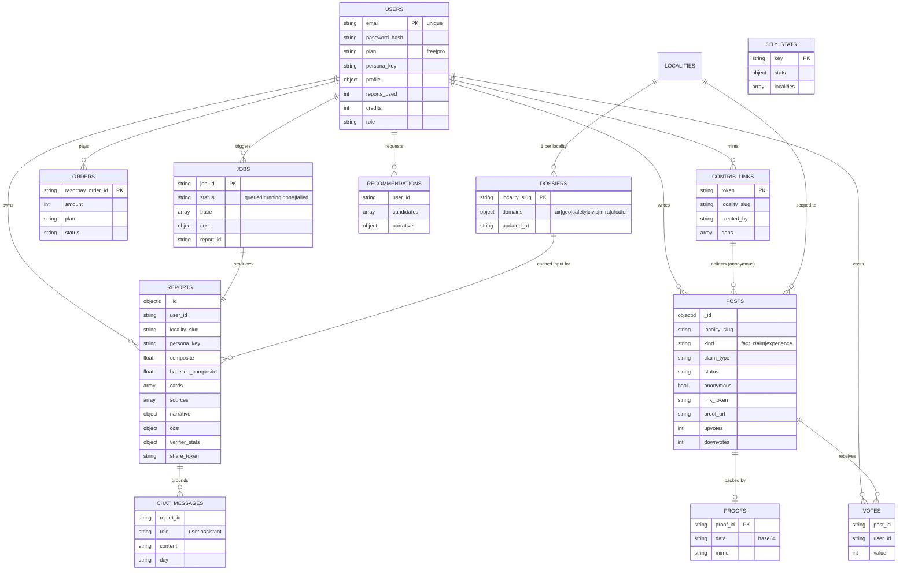

# 03 · Data Model

MongoDB, 14 collections, accessed through Motor. Documents are written by explicit field, never by
spreading a raw Mongo doc into a response — `_id` is always converted to a string `id` at the API
boundary.

## Entity relationships



## Collections

| Collection | Purpose | Notable fields |
|---|---|---|
| `users` | accounts + entitlements | `plan`, `reports_used`, `credits`, `persona_key`, `profile` |
| `reports` | finished reports | `cards[]`, `sources[]`, `narrative`, `cost`, `verifier_stats`, `share_token` |
| `jobs` | one agent run | `trace[]` (streamed to the UI), `cost`, `status` |
| `dossiers` | **the cache** — one doc per locality, one sub-doc per layer | `domains.{air,geo,safety,civic,infra,chatter}` each with `collected_at` |
| `posts` | community claims + experiences | `status`, `anonymous`, `link_token`, `proof_url`, `pii_scrubbed` |
| `contrib_links` | shareable contribution links | `token`, `gaps[]`, `created_by` |
| `proofs` | base64 photo proof | `proof_id`, `mime` |
| `votes` | one vote per user per post | `value` ±1 |
| `chat_messages` | grounded chat history | `day` (used for the 100/day cap) |
| `orders` | Razorpay orders (test mode) | `razorpay_order_id`, `status` |
| `recommendations` | recommendation runs | `candidates[]`, `evaluated` |
| `city_stats` | city-wide medians for the "vs city" comparisons | `stats` |
| `login_attempts` | brute-force protection | — |
| `traces` | reserved for long-term trace retention | — |

## Indexes (created at startup in `db.py`)

```
users.email                      unique
reports.(user_id, created_at)    compound, descending
reports.share_token
jobs.job_id                      unique
dossiers.locality_slug           unique
posts.(locality_slug, created_at)
posts.(link_token, day)          quota lookups
votes.(post_id, user_id)         unique — one vote per user per post
orders.razorpay_order_id
contrib_links.token              unique
contrib_links.(created_by, locality_slug)
```

## Freshness policy

Cached per layer, evaluated by `services/cache.py` on every run.

| Layer | TTL | Rationale |
|---|---|---|
| `air` | 6 hours | AQI moves within a day |
| `geo` | 30 days | OSM amenity mesh barely moves |
| `safety` | 7 days | news-driven |
| `civic` | 14 days | water/power reporting is episodic |
| `infra` | 60 days | metro/road projects move in quarters |
| `chatter` | 7 days | forum sentiment |
| `community` | always live | residents post continuously |

## Claim status ladder

| Status | How it is reached | Enters the score? |
|---|---|---|
| `unverified` | anonymous contribution via a shared link | **no** |
| `pending` | one account holder, with proof | no |
| `corroborated` | a second account holder agrees | partially, lower confidence |
| `verified` | 2+ account holders **and** photo proof | yes |
| `disputed` | contradicting claims | no — both sides rendered |
| `removed` | moderation | no |

`_reconcile_claim_status` explicitly excludes `anonymous: true` documents, and
`collectors.collect_community` excludes them from the contributor set — so no volume of anonymous
posts can promote a claim.

## Live corpus (see `reports/app_stats.json` for the generated snapshot)

| Entity | Count |
|---|---|
| Users | 126 |
| Reports | 64 |
| Agent runs (jobs) | 33 |
| Cached dossiers | 34 (full Bengaluru coverage) |
| Community posts | 112 — 27 verified · 77 pending · 8 anonymous unverified |
| Photo proofs | 31 |
| Votes | 48 |
| Chat messages | 275 |
| Orders (test mode) | 50 |
| Contribution links | 1 |
