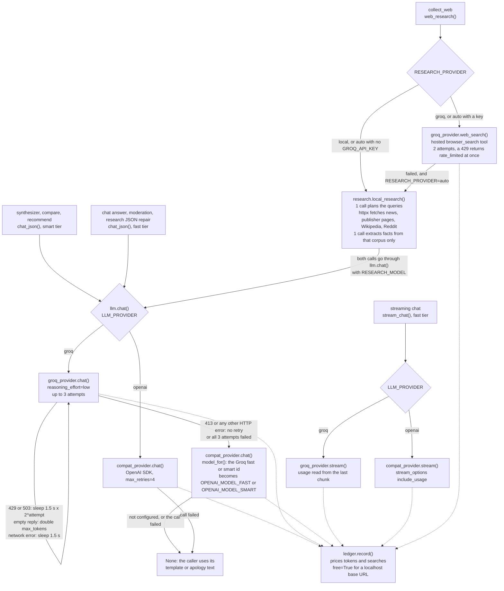
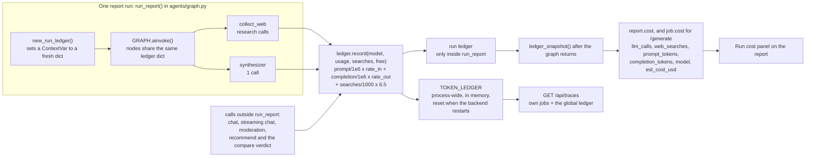

# 05 · Cost Model

Every LLM call goes through `backend/app/services/llm/`. Each provider calls `ledger.record()` with
the response's token usage as soon as the call returns, so the cost shown in a report's **Run
cost** panel is the sum of the calls made during that run, priced from a table in the code. It is
an estimate from published per-token rates, not a figure from a provider invoice.

## Model tiers

Agents ask for a tier, never a vendor model id. `config.py` resolves the tier for the active
provider.

| Tier | Setting | Used by | `LLM_PROVIDER=groq` | `LLM_PROVIDER=openai` |
|---|---|---|---|---|
| smart | `model_smart` | synthesizer, compare verdict, recommend narrative | `GROQ_MODEL_SMART` = `openai/gpt-oss-120b` | `OPENAI_MODEL_SMART` (template: `gpt-5.4`; falls back to FAST when unset) |
| fast | `model_fast` | chat, streaming chat, post moderation, research JSON repair | `GROQ_MODEL_FAST` = `openai/gpt-oss-20b` | `OPENAI_MODEL_FAST` (template: `gpt-5.4-mini`) |
| research | `research_model` | key-free research: query planning and extraction | `RESEARCH_MODEL`, else the fast tier | same |
| search | `model_search` | Groq `browser_search` calls | `GROQ_SEARCH_MODEL` = `openai/gpt-oss-20b` | not used |

## Pricing table

`PRICING` in `services/llm/ledger.py`, USD per million tokens:

| Model | Input | Output |
|---|---|---|
| `openai/gpt-oss-20b` | 0.075 | 0.30 |
| `openai/gpt-oss-120b` | 0.15 | 0.60 |
| `gpt-5.4` | 2.50 | 15.00 |
| `gpt-5.4-mini` | 0.75 | 4.50 |
| `gpt-5.4-nano` | 0.15 | 0.60 |
| any other model id (`DEFAULT_RATE`) | 0.15 | 0.60 |
| any model behind a `localhost` or `127.0.0.1` `OPENAI_BASE_URL` | 0 | 0 |
| Groq hosted search (`SEARCH_USD_PER_1K`) | $6.50 per 1,000 searches | |

```
cost = prompt_tokens / 1e6 × rate_in + completion_tokens / 1e6 × rate_out + searches / 1000 × 6.5
```

`gpt-5.4-nano` is priced but no default setting uses it. Searches are counted only on the Groq
`browser_search` path; the key-free research pipeline makes plain HTTP requests and is billed only
for its two LLM calls per layer.

## LLM call routing

<sub>Source: [`diagrams/llm-routing.mmd`](../diagrams/llm-routing.mmd)</sub>



| Entry point | Routing | Retries | Fallback |
|---|---|---|---|
| `chat()`, `chat_json()` with `LLM_PROVIDER=groq` | Groq first | up to 3 attempts: 429 or 503 sleep 1.5 s × 2^attempt; network errors sleep 1.5 s; an empty reply doubles `max_tokens`; 413 and other HTTP errors stop at once | the OpenAI-compatible provider, same tier via `model_for()`, if it has an API key or a localhost URL |
| `chat()`, `chat_json()` with `LLM_PROVIDER=openai` | OpenAI-compatible only | the OpenAI SDK's own retries, `max_retries=4` | none |
| `stream_chat()` | the active provider only | none | none; the chat agent sends an apology if nothing was streamed |
| `web_research()` | `RESEARCH_PROVIDER`: `local`, or `auto` without `GROQ_API_KEY`, goes to `research.local_research()`; otherwise Groq `browser_search` | Groq: 2 attempts; a 429 returns `rate_limited` at once | under `auto`, a failed Groq search falls back to `local_research()` |

Groq chat and `browser_search` requests set `reasoning_effort="low"`; Groq streaming does not.
Chat and streaming requests on both providers ask for at least 700 output tokens. When every route
fails, `chat()` returns `None` and each caller has a fixed fallback: the template narrative, an
apology in chat, or "not toxic" for moderation.

## LLM calls per user action

Counts are logical calls from the code paths. A Groq call that returns an empty reply is retried
and each response is billed, and a fallback to the second provider is a second billed call.

| Action | LLM calls | Recorded in |
|---|---|---|
| Open an existing report, or `/generate` for a locality and persona you already have | 0 | — |
| `/generate` on a locality with every layer fresh | 1 synthesizer (smart) | run ledger + process ledger |
| `/generate` with stale research layers, key-free path | 1 synthesizer + 2 per stale research layer (plan and extract), +1 repair when a reply has no JSON; at most 4 layers per run | run ledger + process ledger |
| `/generate` with stale research layers, Groq search | 1 synthesizer + 1 `browser_search` call per stale research layer, +1 repair when needed | run ledger + process ledger |
| `/lens` (switch persona) | same as `/generate` without `force`: 1 synthesizer + research for any stale layer | run ledger + process ledger |
| `/compare` with N = 2 or 3 localities | N full graph runs (N synthesizer calls + research for stale layers) + 1 compare verdict (smart) | each run's own ledger (not returned to the client) + process ledger; the verdict only in the process ledger |
| `/recommend` | 1 (smart); the 10 candidates are scored without an LLM | process ledger |
| Chat question, JSON or streamed | 1 (fast) | process ledger |
| Community post or anonymous contribution | 1 moderation call (fast) | process ledger |
| Scoring, verification, golden evals, landing-page re-weighting, chat suggestion chips | 0 | — |

## Per-run ledger

<sub>Source: [`diagrams/cost-ledger.mmd`](../diagrams/cost-ledger.mmd)</sub>



`run_report()` calls `new_run_ledger()`, which puts a fresh dict in a `contextvars.ContextVar`.
LangGraph nodes inherit the context, so every `record()` during the run adds to that dict as well as
to the process-wide `TOKEN_LEDGER`. Two runs in flight at once each have their own dict, so they
cannot bill each other. After the graph returns, `ledger_snapshot()` becomes `report.cost`, and
`job.cost` for runs started by `/generate`.

Both providers call `record()`, so a call that falls back from Groq to the second provider is still
counted. When a run records no calls at all, `cost.model` reads `none — served from cache`. That
string also appears when every LLM call failed (for example with no key configured), because failed
calls have no usage to record.

Calls made outside `run_report()` (chat, moderation, recommend, and the compare verdict) only reach
`TOKEN_LEDGER`, which lives in memory and resets when the backend restarts. `GET /api/traces`
returns it next to the caller's last 20 jobs, and the Account page shows it as "Agent ledger (this
server)".

## Measured spend (earlier hosted deployment)

> These figures were measured on an earlier hosted deployment that used the OpenAI-compatible
> provider with `gpt-5.4` (smart) and `gpt-5.4-mini` (fast). They are not measurements of the
> current local setup or of the Groq default, whose listed rates are much lower. Re-measure on the
> current provider by generating reports and running
> `backend/.venv/bin/python project/scripts/collect_stats.py`, which overwrites
> `project/reports/app_stats.json`.

From `project/reports/app_stats.json` (generated 2026-09-03):

| Metric | Value |
|---|---|
| Agent runs recorded | 33, of which 30 have a cost block |
| LLM calls | 119 |
| Prompt tokens | 591,847 |
| Completion tokens | 60,978 |
| Hosted web searches | 17 |
| Total spend | $1.03 |
| Average per costed run | $0.034 |
| Median run wall time | 12.7 s (median of all 33 runs, warm and cold) |
| Fastest / slowest run | 8.1 s / 165.5 s |

`collect_stats.py` takes the median over every job that has `created_at` and `finished_at`; it does
not separate warm from cold runs.

## Where the cost is visible

- Each report has a **Run cost** panel: LLM calls, web searches, prompt and output tokens, model,
  estimated cost. A report without a cost block shows `not recorded` rather than `$0`.
- `GET /api/traces` returns per-job cost and the process ledger.
- The mechanisms that keep the number down are listed, with file and function, in
  [08 · Call optimizations](08-call-optimizations.md).
