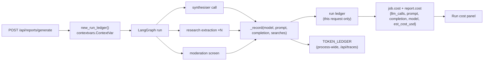

# 05 · Cost Model

Every LLM call in LocalIQ is metered and priced at the moment it returns. The number shown in the
report's **Run cost** panel is the actual cost of producing *that* report, not an estimate.

## Pricing table (`services/llm.py`)

| Model | Input $/1M | Output $/1M | Used for |
|---|---|---|---|
| `openai/gpt-oss-20b` (Groq) | 0.075 | 0.30 | collectors, structuring, chat |
| `openai/gpt-oss-120b` (Groq) | 0.15 | 0.60 | synthesiser narrative, comparison, recommendation |
| `gpt-5.4` | 2.50 | 15.00 | smart tier on the OpenAI-compatible provider |
| `gpt-5.4-mini` | 0.75 | 4.50 | fast tier: research extraction, chat, moderation screening |
| `gpt-5.4-nano` | 0.15 | 0.60 | cheap classification |
| Any other model | 0.15 | 0.60 | `DEFAULT_RATE` |
| Local model (Ollama, LM Studio) | 0 | 0 | any `OPENAI_BASE_URL` on localhost |
| Hosted web search | $6.50 / 1,000 searches | | **no longer used** — replaced by the key-free pipeline |

```
cost = prompt_tokens/1e6 × rate_in + completion_tokens/1e6 × rate_out + searches/1000 × 6.5
```

## Per-run ledger

The bug this design fixed: calls made through the fallback provider were not being counted, so the
UI cheerfully reported `$0.00` for a run that had cost real money.



`contextvars` is what makes two concurrent report generations unable to bill each other — each
request gets its own ledger, while a process-wide ledger keeps the global totals for `/api/traces`.

## Measured spend

Snapshot over the whole production corpus (regenerate with `scripts/collect_stats.py`):

| Metric | Value |
|---|---|
| Agent runs recorded | 33 (30 with cost recorded; 3 predate the ledger) |
| LLM calls | 119 |
| Prompt tokens | 591,847 |
| Completion tokens | 60,978 |
| **Total spend** | **$1.03** |
| **Average per costed run** | **$0.034** |
| Median run wall time | 12.7 s (warm dossier) |
| Slowest run | 165.5 s (cold locality, full web research) |
| Paid web searches | 0 |

### Where the money goes

| Stage | Model | Typical calls/run | Share of cost |
|---|---|---|---|
| Web research extraction (cold only) | gpt-5.4-mini | 0-4 | high on cold runs, zero on warm |
| Narrative synthesis | gpt-5.4 | 1 | dominant on warm runs |
| Chat / moderation | gpt-5.4-mini | on demand | small |

## The three levers that keep it at ~3 cents

1. **Layer-level dossier caching.** A warm locality costs one synthesiser call. The 34 Bengaluru
   dossiers are already built, so the common path is warm.
2. **Key-free retrieval.** The old Groq hosted-search path billed $6.50 per 1,000 searches.
   `research.py` replaced it with Google News RSS → publisher article → Wikipedia → Reddit over plain
   `httpx`. **Paid searches since: zero.**
3. **Deterministic everything-else.** Scoring, lens switching, comparison deltas, suggestion chips,
   the entire eval suite — no LLM involved. Switching persona re-scores a stored dossier for free.

## Unit economics

| | |
|---|---|
| Cost per warm report | ~$0.02 |
| Cost per cold report | ~$0.05-0.09 |
| Free tier | 5 reports ≈ $0.10-0.45 exposure per signup |
| Pro Monthly | ₹499 ≈ $6 — roughly 170 warm reports of headroom |
| Pro Annual | ₹4,499 ≈ $54 |

## Transparency in the product

- Every report carries a **Run cost** panel: LLM calls, web searches, prompt/completion tokens,
  model, estimated cost.
- `/api/traces` returns per-job cost plus the process-wide ledger.
- Reports generated before the ledger existed honestly display `not recorded` rather than `$0.00` —
  including the two seeded demo reports.
